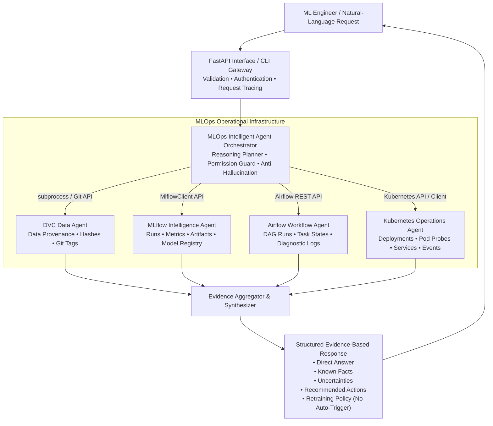
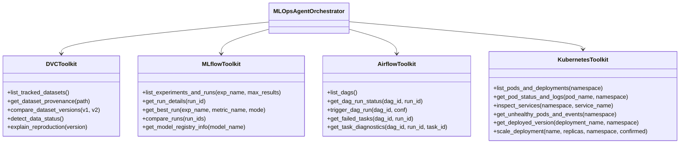
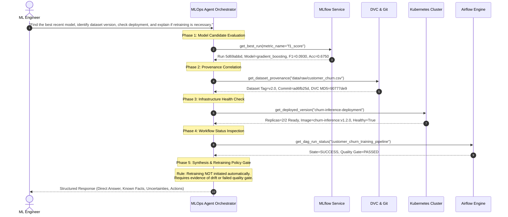

# System Architecture: Production-Ready MLOps AI Agent

This document details the architectural design, security boundaries, tool definitions, and operational workflows of the Intelligent MLOps AI Agent.

---

## 1. High-Level Logical Architecture

The system enables machine-learning engineers to query, operate, diagnose, and govern end-to-end machine learning infrastructure through a single conversational interface. Crucially, the agent does **not** generate speculative responses from language model weights; every claim is grounded in structured, auditable evidence fetched from operational tooling.

---

## 2. Core Modules & Tool Definitions

The agent integrates four domain-specific toolkits, providing at least three callable structured tools per module.

### 2.1 Task 1: DVC Data Management Agent
* **Purpose**: Tracks dataset lineage, detects uncommitted mutations, compares data releases, and provides deterministic checkout commands.
* **Security Control**: Subprocess execution is guarded by an allowlist (`git`, `dvc`) with strict rejection of shell metacharacters (`;`, `&`, `` ` ``, `$`) to prevent shell injection.
* **Tools**:
  1. `list_dvc_tracked_datasets`: Scans repository for `.dvc` files and extracts MD5 pointers and file sizes.
  2. `get_dataset_provenance`: Returns Git commit SHA, Git tag, DVC MD5 hash, author, and remote location.
  3. `compare_dataset_versions`: Computes difference between two tagged Git/DVC revisions.
  4. `detect_data_status`: Identifies modified, deleted, or uncommitted data files via `dvc status`.
  5. `explain_reproduction`: Emits precise `git checkout <tag>` and `dvc checkout` commands.

### 2.2 Task 2: MLflow Experiment Intelligence Agent
* **Purpose**: Inspects model training runs, parameters, metrics, artifacts, and registry governance.
* **Technical Standard**: Uses the official Python `MlflowClient` API directly instead of fragile web scraping.
* **Governance Standard**: Evaluates multi-dimensional criteria (accuracy, latency SLA budget, dataset version) rather than naively crowning the highest raw F1-score as production-ready.
* **Tools**:
  1. `list_experiments_and_runs`: Searches recent runs, ordering by timestamp.
  2. `get_run_details`: Fetches full parameter dictionary, metrics history, and artifact directory list.
  3. `get_best_run`: Ranks candidate models against target metrics and enforces production readiness standards.
  4. `compare_runs`: Generates side-by-side metric and hyperparameter comparisons across multiple run IDs.
  5. `get_model_registry_info`: Inspects registered models, current stages (`Production`, `Staging`), and version tags.

### 2.3 Task 3: Apache Airflow Workflow Agent
* **Purpose**: Interacts with the workflow orchestrator to inspect DAG statuses, trigger pipeline runs, and diagnose task failures.
* **Technical Standard**: Communicates with the Airflow REST API using HTTP Basic / Bearer token authentication, with local DAG inspection fallback.
* **Required Training DAG**:
  Implements 5 sequential stages with retry policies (`retries=2`, `retry_delay=10s`) and strict failure propagation:
  $$\text{validate\_dataset} \longrightarrow \text{preprocess\_data} \longrightarrow \text{train\_model} \longrightarrow \text{evaluate\_and\_log\_mlflow} \longrightarrow \text{apply\_model\_quality\_gate}$$
* **Tools**:
  1. `list_dags`: Lists active DAGs and descriptions.
  2. `get_dag_run_status`: Reports execution state, start/end timestamps, and task completion breakdown.
  3. `trigger_dag_run`: Triggers execution for allowlisted training DAGs only (`customer_churn_training_pipeline`).
  4. `get_failed_tasks`: Identifies tasks in `failed` or `upstream_failed` state.
  5. `get_task_diagnostics`: Extracts stderr/stdout logs and outputs actionable remediation recommendations.

### 2.4 Task 4: Kubernetes Operations Agent
* **Purpose**: Monitors health, logs, and ingress for containerized inference microservices running on Kubernetes.
* **Safety Rules**:
  1. **Namespace Isolation**: Strictly limited to approved operational namespaces (`default`, `mlops`). Non-approved namespaces (e.g. `kube-system`) are immediately rejected.
  2. **State-Altering Safety Gate**: Any cluster mutation (e.g., scaling replicas) requires explicit confirmation (`confirmed=True`). Unconfirmed commands are blocked with a safety alert.
* **Inference Manifests**:
  - `kubernetes/deployment.yaml`: Configured with 2 replicas, rolling updates, CPU (250m/1000m) and memory (256Mi/512Mi) requests/limits, HTTP liveness (`/health/live`), and readiness (`/health/ready`) probes.
  - `kubernetes/service.yaml`: ClusterIP service routing port 80 to container port 8000.
  - `kubernetes/configmap.yaml`: Stores non-sensitive runtime configurations (`MODEL_NAME`, `ENVIRONMENT`, `LOG_LEVEL`).
* **Tools**:
  1. `list_pods_and_deployments`: Inspects desired vs available replicas and pod phases.
  2. `get_pod_status_and_logs`: Tails recent container logs for diagnostic triage.
  3. `inspect_services`: Validates service endpoint routing and cluster IPs.
  4. `get_unhealthy_pods_and_events`: Detects `CrashLoopBackOff`, `OOMKilled`, and health probe failures.
  5. `get_deployed_version`: Validates live image tag and container version.
  6. `scale_deployment`: Adjusts replica count under explicit confirmation.

---

## 3. Multi-Tool Reasoning & Mandatory Integration Scenario

---

## 4. Safety, Reliability & Hallucination Prevention

1. **Zero-Hallucination Protocol**:
   When an external system is unreachable (e.g., MLflow tracking server offline), the agent does not fabricate fallback metrics or hallucinate fake run IDs. Instead:
   - Tool execution is logged with status `ERROR`.
   - The failure is explicitly documented in the **Uncertainties & Boundaries** section.
   - Recommended actions guide the engineer to restore the service.

2. **No-Secret Policy**:
   All telemetry logs record tool name, duration in milliseconds, status code, and unique UUID `request_id`. Sensitive credentials (tokens, passwords, certificates) are stripped and never printed in logs or artifacts.

3. **Restricted Command Allowlist**:
   Direct OS execution is strictly constrained to safe Git and DVC operations, preventing arbitrary remote code execution.
